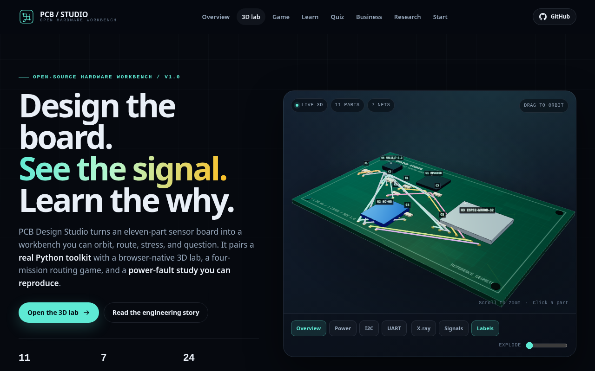
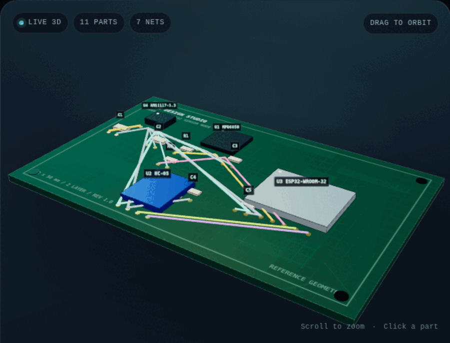
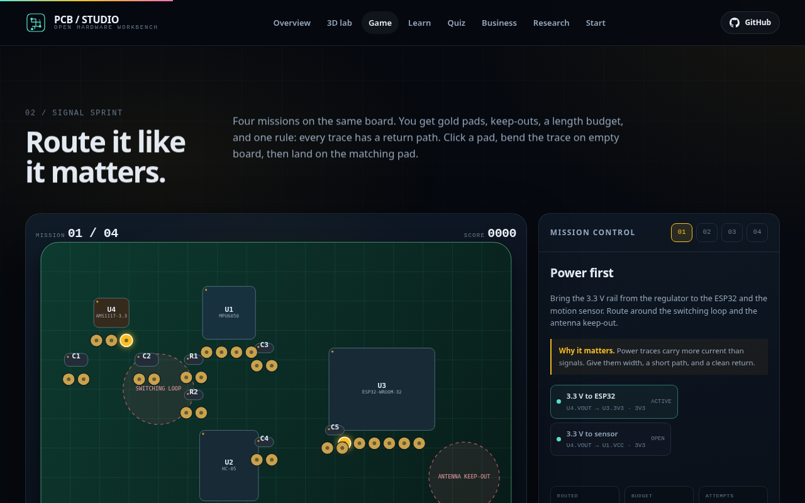
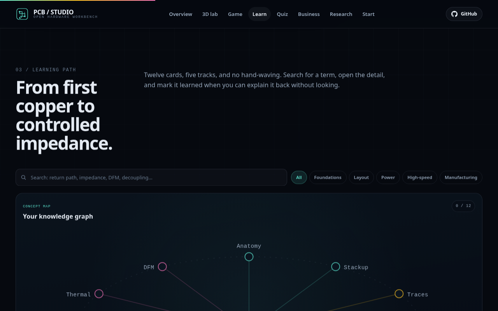
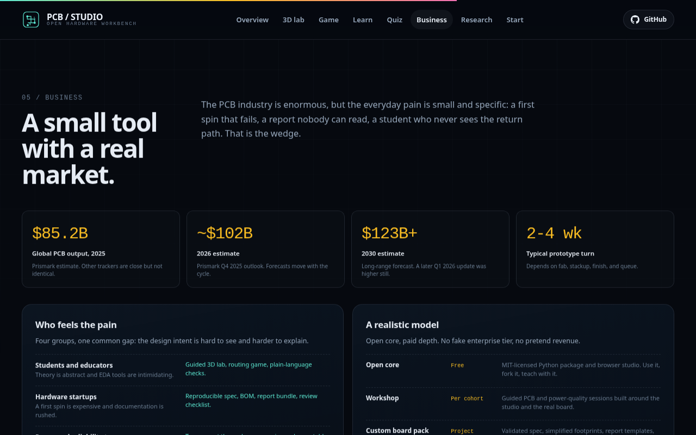

<div align="center">

# PCB Design Studio

**A validated sensor board, a transparent three-phase fault study, and a 3D studio you can touch — in one open repository.**

[Live studio](https://m0-ar.github.io/pcb_design/) · [Quickstart](#quickstart) · [Python API](#python-api) · [Research](#research-and-limitations) · [Issues](https://github.com/M0-AR/pcb_design/issues)

[](https://github.com/M0-AR/pcb_design/actions/workflows/ci.yml)
[](https://github.com/M0-AR/pcb_design/releases)
[](LICENSE)
[](pyproject.toml)
[](tests)

</div>



## Executive summary

PCB Design Studio is an MIT-licensed engineering workbench with two halves that reinforce each other:

- **A real Python package** that describes an 11-component MPU6050 + ESP32 sensor board, validates every pin and net, exports a bill of materials, simulates balanced three-phase voltage with open-phase and short-circuit faults, detects the fault from a windowed RMS ratio, and writes Excel, Markdown, CSV, and JSON reports.
- **A static browser studio** that makes the same board and method tangible: an orbitable 3D board, a four-mission routing game, twelve concept cards with a knowledge map, a ten-question quiz with explanations, a business model, and a reproducible research note.

The Python package is the source of truth. The studio is the guided view. Neither requires an account, a tracking script, or a build step.

| At a glance | |
|---|---|
| Reference board | 80 × 50 mm, 2-layer, 1.6 mm, 11 parts, 24 connections, 7 nets, $9.96 illustrative BOM |
| Analytics | 10 kHz sampling, 50 Hz line frequency, 311 V peak, nominal / open-phase / short-circuit scenarios |
| Outputs | `board_spec.json`, `bom.csv`, `fault_analysis.xlsx`, `report.md`, `summary.json` |
| Browser studio | 3D lab, 4 routing missions, 12 concept cards, 10-question quiz, ROI calculator |
| Quality | 42 tests passed, 1 integration test skipped when KiCad is absent; Ruff clean |
| License | MIT — use it, fork it, teach with it |

---

## 🌱 Beginner guide — read this and you are a professional

If you have never designed a PCB, start here. You do not need KiCad, a soldering iron, or a physics degree to follow the first ten minutes.

A PCB is a mechanical plate with layers of copper inside it. Components sit on the outside. Copper traces connect their pins. Every trace needs a path for current to return, and every return path is part of the circuit — not an afterthought.

### The 60-second tour

1. **Open the studio.** Use the [live site](https://m0-ar.github.io/pcb_design/) or run it locally with the two commands in [Quickstart](#quickstart).
2. **Orbit the 3D board.** Drag to rotate, scroll to zoom, and click any part. The panel on the right tells you its role, footprint, pads, and nets.
3. **Play one mission.** In Signal Sprint, click a gold pad, bend the trace on empty board, then click the matching pad. The game scores your length against the budget and rejects keep-out violations.
4. **Read one concept card.** Open *Grounding and return paths*. Mark it learned when you can explain why high-frequency return current flows under the trace.
5. **Take the quiz.** Every answer gets an explanation, so a wrong answer points you to the card you should revisit.

### Six words that make the rest of this README readable

| Term | Plain meaning |
|---|---|
| **Copper** | The conductive layer that carries current. |
| **Net** | A named set of pins that must be electrically connected. |
| **Trace** | A copper wire on the board. Width depends on current and temperature rise. |
| **Via** | A plated hole that connects traces on different layers. |
| **Return path** | The route current takes back to its source. At high frequency it follows the reference plane under the signal. |
| **DFM** | Design for manufacturing: respecting the fab’s drill, clearance, mask, and panel limits. |

### What is deliberately simplified

This is a teaching and prototyping workbench, not a fabrication sign-off tool. Footprints and traces are reference geometry. The fault detector is a transparent RMS heuristic, not a certified relay. Read [Research and limitations](#research-and-limitations) before you put anything on a real board.

---

## Why this exists

Most beginners see a green rectangle. Engineers see a power tree, a return path, a timing budget, a stackup, and a manufacturing contract. The gap between those views is where first spins fail and where design intent gets lost between layout, power, and documentation.

PCB Design Studio closes that gap in two directions:

- **From the board to the explanation.** The studio turns layout choices into visible cause and effect. You can orbit the board, isolate a net, route a trace, and see why a keep-out exists.
- **From the explanation to an artifact.** The Python package turns the same choices into a validated specification, a BOM, a fault study, and a report bundle that another engineer can rerun.

The product is the workflow: **design → constrain → analyze → explain**. The 3D studio is how you feel it. The package is how you ship it.

---

## See it in action

### The 3D lab

The board explodes into its functional groups, nets can be isolated, and every part is clickable.



### Signal Sprint

Four missions on one board, each with a length budget, keep-outs, and a return-path lesson.



### The learning path

Twelve cards, five tracks, and a knowledge map that lights up as you mark concepts learned.



### The business view

A small, specific wedge in a large market — with the arithmetic and the risks shown.



---

## Quickstart

**Requirements:** Python 3.10 or newer. KiCad 8+ is optional. The studio needs only a modern browser.

```bash
git clone https://github.com/M0-AR/pcb_design.git
cd pcb_design

python -m venv .venv
source .venv/bin/activate          # Windows: .venv\Scripts\activate
python -m pip install --upgrade pip
python -m pip install -e ".[dev]"

pcb-design doctor
pcb-design demo --out-dir demo-output
```

The demo writes the complete bundle without KiCad:

| File | Contents |
|---|---|
| `board_spec.json` | Validated board specification and metadata |
| `bom.csv` | Bill of materials with quantities, unit costs, and totals |
| `fault_analysis.xlsx` | Waveform sheets, statistics, detection, and field reference |
| `report.md` | Human-readable engineering report |
| `summary.json` | Compact machine-readable result for automation |

If your system Python is externally managed (PEP 668), the virtual environment above avoids the conflict. If you already use `uv`, the equivalent is `uv venv && uv pip install -e ".[dev]"`.

### Run the browser studio

```bash
python -m http.server 8931 --bind 127.0.0.1
```

Open <http://127.0.0.1:8931/>. The site is plain HTML, CSS, and ES modules. Three.js r160 is vendored in `assets/vendor/`, so it works offline and needs no bundler.

### Run the quality gates

```bash
pytest
ruff check src tests examples scripts
```

Expected: `42 passed, 1 skipped` on a machine without KiCad. The skipped test is the optional `pcbnew` integration.

---

## Command line

```text
pcb-design spec      Print or write the reference board JSON.
pcb-design board     Export the reference board to KiCad (.kicad_pcb).
pcb-design analyze   Simulate a three-phase fault and report statistics.
pcb-design demo      Build the complete demo bundle.
pcb-design doctor    Check the Python environment and optional KiCad bridge.
```

### Reproduce a specific study

```bash
pcb-design analyze \
  --fault short \
  --phase B \
  --seed 7 \
  --output analysis.xlsx \
  --report report.md \
  --json summary.json
```

All scenario inputs are explicit: fault type, phase, duration, sample rate, line frequency, peak voltage, fault start time, and seed. The same inputs produce the same report.

### Export to KiCad

```bash
pcb-design board --output board.kicad_pcb
```

This command requires the `pcbnew` Python module that ships with KiCad. Without it, the command exits with a clear message instead of a stack trace. Run `pcb-design doctor` to see whether the bridge is available.

---

## Python API

```python
from pcb_design import analyze_faults, default_board

board = default_board()
print(board.name)                 # MPU6050 + ESP32 sensor node
print(len(board.components))      # 11
print(round(board.bom_total(), 2))  # 9.96

analysis = analyze_faults(fault="short", fault_phase="B", seed=7)
print(analysis.detection["phase"])     # B
print(analysis.detection["severity"])  # 0.919
```

The public API is intentionally small:

| Symbol | Purpose |
|---|---|
| `BoardSpec`, `Component`, `Connection` | Typed, validated board description |
| `default_board()` | The reference 11-part sensor node |
| `simulate_three_phase()` | Raw waveform DataFrame |
| `analyze_faults()` | Simulation + statistics + detection + reference table |
| `detect_fault()` | Windowed RMS detector on an existing waveform |
| `export_kicad()` | Optional `.kicad_pcb` export |
| `FaultAnalysis.summary()` | JSON-friendly result |

`BoardSpec.validate()` rejects duplicate references, unknown pads, invalid dimensions, and connections that point at pins which do not exist. JSON round-tripping is covered by tests.

---

## The reference board

| Property | Value |
|---|---|
| Name | MPU6050 + ESP32 sensor node |
| Dimensions | 80 × 50 mm |
| Thickness | 1.6 mm |
| Copper layers | 2 |
| Components | 11 |
| Connections | 24 |
| Named nets | 7 |
| Illustrative BOM | $9.96 |

Key parts: **ESP32-WROOM-32** (Wi-Fi/Bluetooth module), **MPU6050** (6-axis motion sensor), **HC-05** (Bluetooth serial module), **AMS1117-3.3** (regulator), and the decoupling, pull-up, and bulk capacitors around them.

The BOM is illustrative, not a purchasing quote. Footprints are simplified reference geometry, not fabrication-ready land patterns. The value of the specification is the constraint model: references, pads, nets, dimensions, and costs are checked before anything is exported.

---

## Power-fault analytics

A balanced three-phase voltage is generated at 10 kHz, 50 Hz, and 311 V peak:

```text
v_a(t) = V_p sin(2πft)
v_b(t) = V_p sin(2πft − 120°)
v_c(t) = V_p sin(2πft + 120°)
```

The detector computes RMS over short windows and compares the weakest window in each phase with the nominal RMS:

```text
V_rms = sqrt((1/N) Σ v[n]²)
severity = 1 − min_w(V_rms,w / V_rms,nominal)
```

The default demo produces these results with seed 7:

| Scenario | Detected | Phase | RMS ratio | Severity | Confidence |
|---|---|---|---|---|---|
| Nominal | none | — | 0.999 | 0.001 | 0.95 |
| Open phase | open | A | 0.350 | 0.650 | 0.90 |
| Short circuit | short | B | 0.081 | 0.919 | 0.95 |

THD is also reported per phase. The open-phase case raises phase A THD to about 8.3%; the short-circuit case raises phase B THD to about 28.6%. These are synthetic signals with controlled noise, not field measurements.

The method is deliberately inspectable. You can read the detector, change the window, change the fault instant, and rerun the same seed. The report records the assumptions so a reviewer can challenge them.

---

## The browser studio

| Section | What it does |
|---|---|
| **3D lab** | Orbit, zoom, explode, isolate power/I2C/UART nets, toggle X-ray and labels, click parts |
| **Signal Sprint** | Four routing missions with length budgets, keep-outs, hints, scoring, and local best scores |
| **Learning path** | Twelve concept cards, five tracks, search, filters, knowledge map, learned-state persistence |
| **Quiz** | Ten questions, immediate explanations, score, best score, restart |
| **Business** | Market context, customer segments, open-core model, transparent ROI calculator |
| **Research** | Equations, validation notes, limitations, references, reproduction commands |

The studio is accessible by design: a skip link, keyboard-operable game tasks, ARIA labels on the 3D canvases, visible focus styles, and non-WebGL fallbacks that keep the board details and mission briefs readable.

Progress is stored only in your browser via `localStorage`. There is no analytics script and no network call after the page loads.

---

## Business case

The PCB industry is large, but the everyday pain is small and specific: a first spin that fails, a report nobody can read, a student who never sees the return path. That is the wedge.

Market context, with dates attached:

| Figure | Meaning | Source and caveat |
|---|---|---|
| **$85.2B** | Global PCB output, 2025 | Prismark estimate; other trackers are close but not identical |
| **~$102B** | 2026 estimate | Prismark Q4 2025 outlook; forecasts move with the cycle |
| **$123B+** | 2030 estimate | Long-range forecast; a later Q1 2026 update was higher still |

These figures show scale, not a specific addressable market for this project. Quote them with their date and scope.

### Who pays, and for what

- **Students and educators** — a guided lab and a reproducible courseware bundle.
- **Hardware startups** — a validated spec, BOM, report bundle, and review trail for a prototype.
- **Power and reliability teams** — transparent scenarios and exportable summaries that survive a cross-discipline review.
- **Training and maker spaces** — open courseware built around a real board and analytics pipeline.

### A simple ROI model

The studio includes an interactive calculator. With 6 engineers, 5 hours per week on rework and documentation, 46 working weeks, 25% reduction, and a $6,000 annual tool cost:

```text
hours saved   = 6 × 5 × 46 × 0.25 = 345 h/year
annual saving = 345 × $55        = $18,975
payback       = $6,000 / $18,975 × 12 = 3.8 months
```

That is a planning estimate, not a promise. The assumptions are visible so a reviewer can change them.

### What could go wrong

- KiCad’s Python API varies by release; the export path is optional and tested separately.
- The fault model is a teaching approximation, not a protection-coordination study.
- The PCB market is crowded; the differentiation is the learning-to-report workflow, not raw EDA features.
- Forecast figures are third-party estimates and should be quoted with their date and scope.

---

## Research and limitations

### Validation

- Synthetic tests cover nominal, open-phase, short-circuit, late-fault, and invalid-input cases.
- Round-trip tests preserve board specifications through JSON and regenerate the BOM.
- The demo bundle builds in CI without KiCad.
- CLI error paths are tested for missing KiCad, invalid input, and unwritable output.

### Limits

- No electromagnetic, thermal, or mechanical solver is included.
- Footprints and traces are simplified reference geometry, not fabrication-ready artwork.
- Fault detection is a transparent RMS heuristic, not a trained classifier or a certified relay.
- The game teaches routing intuition; it is not a substitute for DRC, DFM, or expert review.
- Market figures are third-party estimates, quoted with dates and caveats.

### Next experiments

- Hardware-in-the-loop validation with a relay test set and a calibrated power-quality recorder.
- Expert review against IEC 61000-4-30 measurement classes.
- Stackup impedance and thermal calculations with explicit assumptions.
- A larger board library with fabrication-ready footprints and a DRC/DFM checklist.

---

## Repository layout

```text
.
├── src/pcb_design/
│   ├── board.py          # BoardSpec, validation, BOM, optional KiCad export
│   ├── analytics.py      # Three-phase simulation, statistics, fault detection
│   ├── report.py         # Excel, Markdown, JSON, demo bundle
│   └── cli.py            # pcb-design command line
├── tests/                # 42 passing tests + 1 optional KiCad integration
├── examples/             # Quickstart and KiCad API probe
├── scripts/              # Headless browser smoke test
├── .github/workflows/    # CI, Pages, and release automation
├── assets/
│   ├── css/site.css
│   ├── js/               # data, lab, game, quiz, site, main
│   ├── img/              # screenshots, social card, favicon
│   └── vendor/           # Three.js r160, vendored for offline use
├── index.html            # Static studio
├── 404.html
├── robots.txt
├── sitemap.xml
├── pyproject.toml
└── CITATION.cff
```

The legacy `main.py`, `temp.py`, and `test.py` files are retained only as historical references. The supported entry points are the `pcb_design` package and the `pcb-design` command.

---

## Quality gates

```bash
pytest
ruff check src tests examples scripts
python -m build
```

The optional browser smoke test needs Playwright and Chromium:

```bash
python -m pip install -e ".[dev,site]"
python -m playwright install chromium
python scripts/smoke_site.py
```

Continuous integration runs the test suite, linting, package builds, and that browser smoke test on every push and pull request. The release workflow builds the source and wheel distributions, checks them with Twine, and attaches them to the GitHub release.

This repository deliberately keeps the gates boring: tests that run without hardware, a linter with a fixed rule set, and a package that installs from a clean environment.

---

## Roadmap

- [x] Typed board specification with validation and JSON round-tripping
- [x] Eleven-part reference board with BOM and seven named nets
- [x] Three-phase nominal, open-phase, and short-circuit scenarios
- [x] Windowed RMS detection with severity and confidence
- [x] Excel, Markdown, CSV, and JSON reports
- [x] CLI with `spec`, `board`, `analyze`, `demo`, and `doctor`
- [x] Static 3D studio, routing game, concept library, and quiz
- [x] CI, package builds, and GitHub Pages deployment
- [ ] Fabrication-ready artwork and full DRC/DFM sign-off
- [ ] Hardware-in-the-loop validation and a trained fault classifier
- [ ] Stackup impedance and thermal solvers

---

## Contributing

Small, focused pull requests are welcome. Before opening one:

1. Add or update a test for the behavior you change.
2. Run `pytest` and `ruff check src tests examples scripts`.
3. Keep the README’s claims aligned with what the code actually does.

For bugs, include the command you ran, the expected result, and the actual result. For feature ideas, describe the workflow you are trying to make easier, not only the feature you want.

---

## Citation and license

If you use this work in teaching or research, cite it via [`CITATION.cff`](CITATION.cff).

Released under the [MIT License](LICENSE). You can use, modify, and redistribute it, including commercially, with attribution.

---

<div align="center">

Built with Python, NumPy, pandas, openpyxl, and Three.js. No tracking. No account. No build step.

**If this saves you a first spin, star the repository and tell one person who is learning PCB design.**

</div>
